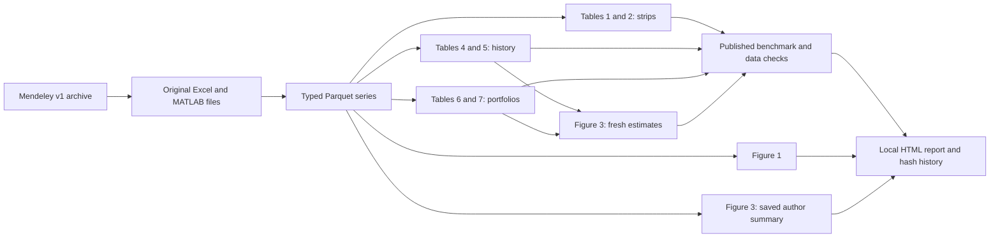

# Python replication: implementation and audit

The local pipeline translates the assigned empirical exhibits of Golez and Koudijs (2025). It estimates from the authors’ supplied series and portfolios, rather than copying table values into outputs. It currently reproduces the original sample ending in 2022. Updated WRDS extraction and the research-product extension remain separate work.

## Run and inspect

```bash
uv sync --frozen
uv run doit                 # download missing inputs, clean, estimate, plot, validate, report
uv run doit accept          # additionally require agreement with the frozen published baseline
uv run doit checks          # numerical tests and isolated end-to-end rebuild tests
uv run python src/watch_pipeline.py  # optional continuous local rebuilding; Ctrl-C stops
uv run doit site            # separate ChartBook documentation build
```

Open `_output/replication/index.html` for all six tables and both figures. Tables have full-precision CSV, HTML and LaTeX exports; figures have SVG and PNG exports plus CSV plot data. The `.tex` files are table fragments for a future report, not standalone documents requiring compilation. No MATLAB runtime is required.

`uv run doit` compares input and code contents with its local SQLite dependency database. Unchanged tasks are skipped; changed dependencies and missing targets trigger rebuilds. Running the watcher makes that check automatic while the process is active. It does not install a background service or push files. `DATA_DIR` and `OUTPUT_DIR` can redirect the data and output roots; `P22_DOIT_DB` selects a separate dependency database for an independent run.

## Source package and rights

Pinned source: [Mendeley version 1](https://data.mendeley.com/datasets/fp6fryn7h3/1), published May 29, 2025; DOI [10.17632/fp6fryn7h3.1](https://doi.org/10.17632/fp6fryn7h3.1). `config/authors_package.json` records the download URL and SHA-256 hashes of all 19 extracted files. The original archive and extracted sources live under ignored `_data/authors/`.

The Mendeley page lists CC BY 4.0. Its package README also restricts redistribution of certain third-party data. Consequently the repository contains a downloader and source manifest, not the Excel data, source paper or original MATLAB files. Credit for the data and original empirical implementation belongs to Benjamin Golez and Peter Koudijs. The `olsnw.m` routine credits James P. LeSage; the Python estimator implements its documented OLS/Bartlett covariance formula. See the retained upstream README and MATLAB headers for attribution and source-specific terms.

The downloader verifies newly extracted files against the pinned hashes and never overwrites an existing local edit. Each successful build records original-file modifications in `_output/replication/provenance/latest.json`. To restore an original, retain a copy of your edit, remove that input, and rerun `doit`; the cached archive supplies the verified original. Edited MATLAB scripts trigger the related task and appear in provenance, but translating a new MATLAB algorithm still requires a deliberate Python edit. The system does not pretend to automatically translate arbitrary upstream code changes.

## Dependency graph



Source ingestion is separated into strips, history, portfolios and saved-summary groups. Numerical routines live in `src/p22/econometrics.py`; analysis modules do not read published benchmarks. Benchmarks are consumed only after estimation by `validation.py`.

## MATLAB-to-Python map

| Author file | Python implementation | Outputs |
|---|---|---|
| `Table_1_2_Dividend_Strip.m` | `strips.py` | Tables 1 and 2 |
| `Table_4_Time_Series.m`, `Table_5_Time_Series.m` | `history.py` | Tables 4 and 5 |
| `Table_6_7_Cross_Section.m` | `portfolios.py` | Tables 6 and 7 |
| `Figure_1_2_Time_Series.m` | `figures.py:payout` | Figure 1 only |
| `Figure_3_Summary.m` | `figures.py:summary` | Figure 3, fresh and saved-summary versions |
| `olsnw.m` | `econometrics.py` | OLS, Newey–West standard errors and t-statistics |

Tables 3, 8 and 9 and Figure 2 are outside the assigned replication scope and are not translated. `BBK_Expected_Ret.xls` is retained in the downloaded package but is not an assigned-exhibit input.

## Numerical conventions preserved

- Sample standard deviations use `ddof=1`. First-order autocorrelation uses the lag-one centered product divided by the full centered sum of squares, matching MATLAB `autocorr`.
- Newey–West uses Bartlett weights and no finite-sample covariance correction. Annual regressions use one lag. Overlapping 12-month strip regressions use 12 lags. The nonoverlapping t-statistic averages 12 separately estimated offsets, each using one lag as in the actual MATLAB script.
- Strip data contain 324 monthly levels from January 1996 through December 2022 and 312 complete 12-month outcomes. Real log returns and growth subtract log inflation. Annual dividend levels form market and 18-month-strip dividend-price ratios.
- Historical returns never cross the Netherlands/UK/U.S. dataset splice boundaries. Ten-year dividend smoothing starts before selecting 1629. Growth through 1700 uses smoothed dividends; dividend-price ratios use smoothing strictly before 1700. Zero actual historical dividends are valid before smoothing; prices and effective log inputs must be positive.
- Table 5’s full-sample persistence adjustment preserves the authors’ repeated 1945 dividend-price level in the rho calculation. The full-period regressions themselves do not double-count the U.S. transition return. Prewar interaction t-statistics come from the full sample with intercept, period indicator, predictor and predictor-by-period interaction.
- Payout portfolios use all six supplied groups: All, Low, Medium, High, Below 0.5 and Above 0.5. The first year, 1945, supplies predictor levels; returns and growth start in 1946. Ten-year payout ratios divide rolling dividend means by rolling earnings means. This does not reconstruct stock sorting from CRSP/Compustat.
- Expected-return and expected-dividend-growth shares retain estimates outside [0,1]. They are regression-based variance-decomposition quantities, not probabilities.

## Figure decisions and source limitations

**Figure 1:** Panel A divides trailing ten-year nominal dividend sums by earnings sums. Panel B averages annual real dividend-price ratios over ten years. The 1871–2022 source yields its first complete window in 1880. The supplied MATLAB script shifts the axis year labels by one year; Python keeps the same calculated values and labels their actual endpoints. Charts retain the paper’s two-panel line structure.

**Figure 3:** `figure_3` uses current full-precision estimates from Tables 4–7, so data or estimator changes propagate. `figure_3_author_summary` separately plots the authors’ frozen, rounded `Data_Summary.xlsx`. Both use the three historical and six cross-sectional observations, distinguish groups by marker shape, and fit a joint descriptive OLS line. Small differences between these versions are expected from saved input rounding. No confidence intervals are invented.

**Table 4 smoothing:** The original MATLAB code supplies 0.21, 0.32 and 0.31 as constants and references an estimation file absent from this package. These three cells are explicitly marked as source constants, excluded from the independently recomputed count, and never presented as a successful Python re-estimation.

**Coverage:** The package provides prepared aggregate series and portfolios. Raw-security construction, updates beyond 2022, and independently recovering those three smoothing estimates need additional data/code. `config/replication.json` makes existing baseline assumptions explicit; changing its endpoint does not fetch new observations. The frozen benchmarks and source constants refer to the original sample, so experimental settings need interpretation and should not be represented as an updated-paper replication.

## Validation evidence

The published reference cells were transcribed from the local published JFE paper (volume **172**, article 104114; the assignment’s volume 171 differs). `config/published_benchmarks.json` fixes the tolerance at **0.0051** for two-decimal printed values and exact equality for integer stock-count extrema. No tolerances were tuned to force table agreement.

| Table | Independently recomputed numeric cells | Within published rounding |
|---|---:|---:|
| 1 | 10 | 10 |
| 2 | 28 | 28 |
| 4 | 27 | 27 |
| 5 | 42 | 42 |
| 6 | 78 | 78 |
| 7 | 78 | 78 |
| **Total** | **263** | **263** |

All eight data checks pass: CPI inflation, two portfolio-count identities, dividend growth versus supplied dividend levels, three real/nominal scaling identities, and nine-point Figure 3 coverage. Portfolio log-growth reconciliation allows `1e-8` for the workbook’s independently stored numerical precision (observed maximum discrepancy `7.37e-10`); this is separate from the published-table tolerance.

Numerical tests compare translated OLS and HAC estimates against Statsmodels at 0, 1 and 12 lags. A temporary-copy integration test builds from the downloaded package, accepts the published baseline, confirms a no-op second run, edits an actual Excel source cell, edits a Python calculation, checks downstream Figure 3 updates and unchanged unrelated branches, and verifies recovery of a deleted output. Production source files remain untouched by those tests.

MATLAB/Octave was not available, so this is not a direct runtime-to-runtime comparison. Evidence consists of formula inspection, independent covariance checks, source identities and agreement with published table cells. Figures were visually inspected. Full comparisons, an original validation chart, diagnostics, source/code/output hashes and append-only JSONL build history are generated locally.

## Repository delivery boundary

Personal study and instructor screenshot materials were removed from the current `main` tree in commit `daea80e`. The Python baseline implementation is also included on `main`, as requested by Lauris Li. Raw inputs, outputs, personal notes and the dependency database remain ignored. Removal from the current cloud tree does not rewrite previous commits; the screenshot image files themselves were never tracked.
